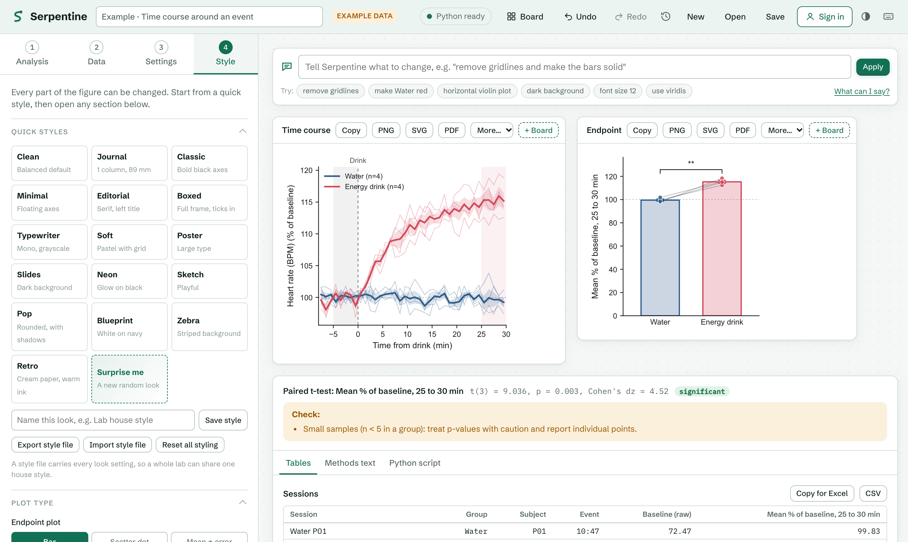

# Serpentine

**Analyze lab data and make publication-quality figures without writing code.**

**[Open Serpentine](https://serpentine.shawi.space/app.html)** · [Website & guide](https://serpentine.shawi.space/) · [Download](https://github.com/Frizzell-5/Serpentine/releases/latest/download/Serpentine.zip)

Serpentine is a browser-based analysis tool for researchers. You paste or upload your data, choose an analysis, adjust the settings and figure style in plain menus, and get statistics, figures and a methods paragraph. Python (NumPy, SciPy, pandas, matplotlib) does the work behind the scenes, right inside the browser, so there is nothing to install and your data never leaves your computer.



## Why Serpentine

- **No code.** Every analysis decision is a menu, toggle or number field. The figure updates as you change them.
- **Complete control over the figure.** Ten plot types, vertical or horizontal; per-group colors, markers, hatch patterns and line styles; any matplotlib colormap; twelve fonts; every axis line, tick and gridline; reference lines, panel letters and legends. Twelve quick styles to start from, your own saved styles, and shareable style files for a lab house style.
- **Plain-English commands.** Type “remove gridlines and make Control navy”, “baseline from -2 to 0”, “make it look professional” or “export as pdf” into the command bar. Hundreds of phrasings, typo correction and suggestions. Runs locally: instant, free and private.
- **Python when you want it.** An optional box runs your own matplotlib code on each figure, and raw rcParams settings take one line each.
- **Built for real lab data.** It reads tables pasted from LabChart Data Pads, Excel and Prism, including multi-row headers, clock times (`10:30`) and European decimal commas.
- **Private by design.** All computation runs locally in your browser through [Pyodide](https://pyodide.org). Optional accounts save projects online with end-to-end encryption: they're encrypted in your browser with your password, so the server only stores data it can't read.
- **Reproducible.** Every analysis can be downloaded as a standalone Python script that recreates the same statistics and figures, for lab records, reviewers or further customization.

## Analyses

| Analysis | What it does |
| --- | --- |
| **Compare groups** | Descriptive statistics; automatic choice between parametric and non-parametric tests based on Shapiro-Wilk normality; Welch's / Student's / paired t-test, Mann-Whitney, Wilcoxon; one-way and repeated-measures ANOVA, Kruskal-Wallis, Friedman; Tukey, Dunnett or Holm-corrected post-hoc comparisons; effect sizes. |
| **Time course around an event** | One table per recording session, aligned to an injection or stimulus. Time binning, value and quality-column filters, per-session exclusion windows, baseline normalization (% of baseline, change, fold), group means with SEM/SD bands, and endpoint statistics (mean, nadir, peak or net AUC), paired by subject when appropriate. |
| **Correlation & regression** | Pearson or Spearman correlation, least-squares linear fit with 95% confidence band, optionally split by group. |
| **Survival** | Kaplan-Meier curves with censoring marks and 95% confidence bands (log-log), median survival with 95% CI, log-rank (Mantel-Cox) test, Holm-adjusted pairwise log-rank tests for 3+ groups, hazard ratio for 2 groups, optional number-at-risk table. |
| **Dose-response** | Four-parameter logistic fit on log concentration, EC50/IC50 with 95% confidence intervals, Hill slope, R², optional fixed top or bottom, multiple curves or replicates. |
| **Two-way ANOVA** | Two factors (e.g. genotype × treatment) with interaction, Type III sums of squares, partial η², optional log/sqrt transform, Šidák comparisons within each level or Tukey across all combinations, grouped plots. Long or Prism-style grouped tables. |
| **Counts & proportions** | Fisher's exact or chi-square test (with expected-count checks), Cramér's V; for 2 × 2 tables the odds ratio, relative risk and risk difference with 95% CIs. Stacked-percent, stacked or side-by-side bars. |
| **Curve fitting** | 16 models (Michaelis-Menten, Hill and one-site binding, one/two-phase decay and association, exponential, logistic and Gompertz growth, Boltzmann, Gaussian, power, polynomials) or a custom equation. Parameter CIs, R², AICc, derived half-lives and doubling times, weighting, confidence bands, residual plots with a runs test, and extra sum-of-squares F tests comparing curves or a single parameter. |
| **Standard curve** | ELISA, BCA, Bradford or any assay: linear, through-origin, quadratic, log-log, 4PL or 5PL fits with optional 1/Y or 1/Y² weighting; blank subtraction; interpolated unknowns with dilution factors; flags for out-of-range samples and high replicate CV; back-calculated standard recovery; LOD/LOQ from blanks. |
| **qPCR gene expression** | Ct to fold change by 2^-ΔΔCt or Pfaffl (gene-specific efficiencies); automatic reference-gene detection and geometric averaging of several; technical-replicate QC; Undetermined wells; reference-gene stability check; statistics on log2 fold change. Reads instrument exports directly. |
| **Repeated measures** | The same subjects measured repeatedly, in one or more groups. Mixed-design or two-way repeated-measures ANOVA (design detected from subject IDs), Greenhouse-Geisser sphericity correction, paired post-hoc tests with Šidák or Holm correction, line plots over time with significance per time point. Validated against pingouin. |
| **ROC curve** | Diagnostic accuracy of one or more markers: AUC with DeLong 95% CI, Youden-optimal cut-off with sensitivity, specificity, PPV and NPV, paired DeLong test between markers, full cut-off table. |
| **Method comparison** | Bland-Altman bias and 95% limits of agreement with confidence intervals (absolute, percent or ratio differences), proportional-bias check, Lin's concordance correlation coefficient and an agreement scatter plot. |
| **Sample size & power** | No data needed. Required n, achieved power or minimum detectable effect for two groups, paired designs, one-way ANOVA, two proportions and correlations (exact noncentral t/F), with dropout and a methods-ready justification. |

Compare groups can also flag or remove outliers (Grubbs' test or Tukey's fences), average technical replicates within each subject before testing (nested designs, no pseudoreplication), and its descriptive table includes the CV. Two-way ANOVA takes an optional subject column for repeated measures.

**Plate reader import:** paste a 96- or 384-well grid and a plate map; standards, blanks and replicates are recognized, previewed on a live plate, and turned into a table that goes straight into a standard curve.

## Output

- Figures as **PNG** or **TIFF** (up to 1200 dpi), **SVG** (editable text for Illustrator or Inkscape), **PDF**, **EPS** and **JPG**, or copied straight to the clipboard
- Results tables that copy straight into Excel or Prism, or download as CSV
- An auto-generated **methods paragraph** naming the tests, corrections and software versions used
- A **Python script** that reproduces the full analysis
- Project files (`.serpentine.json`) to save and reopen your work
- **Figure board:** combine figures from any analyses into one multi-panel figure at journal widths, lettered A, B, C, exported as PNG, TIFF, PDF or editable SVG
- **Report:** results, notes, figures, methods and tables on one printable page
- **Share links:** a link that opens a copy of the whole analysis in anyone's browser, encrypted with a key that exists only in the link (the server can't read it)

## Getting started

Serpentine is a static web app. It needs to be served over HTTP (not opened as a file) because the Python engine runs in a web worker.

**Online:** open <https://serpentine.shawi.space/app.html>. Nothing to install. Create a free account there to save projects online, end-to-end encrypted.

**macOS:** download, unzip and double-click `Start Serpentine.command`.

**Windows:** download, unzip and double-click `Start Serpentine (Windows).bat` (needs [Python 3](https://www.python.org/downloads/)).

**Any system:**

```bash
git clone https://github.com/Frizzell-5/Serpentine.git
cd Serpentine
python3 -m http.server 8765
```

Then open <http://127.0.0.1:8765/app.html>. The first visit downloads the Python runtime and scientific libraries (about 30 MB); the browser caches them for later visits.

To try it without your own data, pick an analysis and press **Try example**.

## Deployment

The main site runs on Cloudflare Pages: the static app plus a small accounts API (`functions/api/`) backed by a D1 database (`schema.sql`). `npm run deploy` copies the site into `dist/` and deploys it; `npm run dev` runs everything locally.

The app also works on any static host without the API (GitHub Pages, the downloadable zip, `python3 -m http.server`); accounts are then simply unavailable and work stays in the browser or in project files.

### How accounts are encrypted

`cloud.js` derives 64 bytes from the password with PBKDF2-SHA256 (600,000 rounds, salted with the email). The first half authenticates (the server stores only a salted SHA-256 of it); the second half never leaves the browser and wraps a random 256-bit data key. Projects and saved styles are gzipped and encrypted with AES-GCM under that data key before upload. The data key is also wrapped with a random recovery key shown once at sign-up, which is the only way to reset a forgotten password.

Share links use a fresh random 256-bit AES-GCM key per link. The encrypted project is uploaded; the key is put only in the link's `#fragment`, which browsers never send to the server. Links expire after 1 to 365 days and can be removed by their creator at any time.

## Project structure

```
index.html          Website: overview, gallery, user guide, FAQ
app.html            The app
app.css             Styles (light and dark themes)
app.js              Interface: steps, settings forms, results, exports
commands.js         Plain-English command reader ("remove gridlines" → settings)
cloud.js            Accounts, end-to-end encryption, online saving, share links
plate.js            Plate-reader import
functions/api/      Accounts and share-link API (Cloudflare Pages Functions + D1)
schema.sql          Database tables
worker.js           Loads Pyodide and the engine off the main thread
engine/serpentine.py   Analysis engine: parsing, statistics, figures, exports
docs/               Screenshots
```

The engine has a single entry point, `api(cmd, args_json)`, and also runs as ordinary Python (`cli()`), which is what the script export uses.

## Adding an analysis

1. In `engine/serpentine.py`, write `analysis_<name>(datasets, settings, style)` returning figures, tables, a summary, notes and methods text, and register it in `ANALYSES`. Add sample data to `example()`.
2. In `app.js`, add an entry to `ANALYSES`, its defaults to `DEFAULT_SETTINGS`, and its form to `SETTINGS_SCHEMA`.

To test the engine outside the browser:

```bash
python3 -m venv .venv && .venv/bin/pip install numpy scipy pandas matplotlib openpyxl
.venv/bin/python -c "import sys; sys.path.insert(0, 'engine'); import serpentine; print(serpentine.api('example', '{\"kind\": \"compare\"}')[:200])"
```

## Roadmap

- Linear mixed models for unbalanced repeated measures
- Axis breaks and inset plots
- Direct import of LabChart `.adicht` files

## Status

Serpentine is at v1.0. Results should be checked against your own understanding of the statistics before publication; the generated methods text is a starting point, not a substitute for describing what you did.

## Author

Shadan Alrawi
